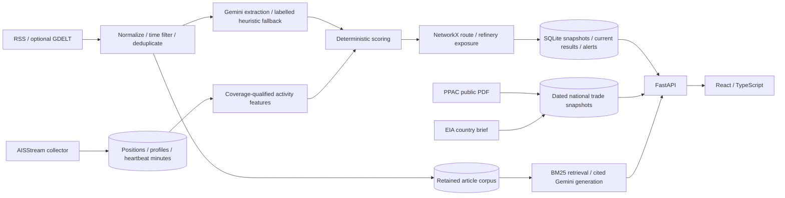

# Architecture

The core chain is `Signal -> RiskExtraction -> RiskAssessment -> RouteRisk -> RefineryExposure`. Gemini extracts structured facts; deterministic arithmetic assigns scores. The React application talks only to FastAPI over HTTP.

News score is event weight × severity × confidence × credibility × recency × speculative discount. Route evidence uses noisy-OR. Brent corroboration applies only with news evidence. AIS can increase a news-supported route score by at most 10% of its remaining headroom, and only after the configured qualified baseline and current coverage exist. Missing or zero-observation AIS windows do not increase risk. See `pipeline/vessel_features.py` for the exact rule and limitations.

AIS has a separate long-running collector, not an HTTP request that waits for a stream. It persists Class A positions, static ship type when received and subscription heartbeat minutes. The default baseline needs 720 qualifying hours (30 days). Heartbeats measure connection coverage, not guaranteed receiver delivery. No observed crossings or crude cargo quantities are inferred from position counts.

Live data and each replay have separate namespaces. Current display tables can be replaced within a namespace; run logs, complete risk/evidence snapshots, article corpus and alerts are retained. A total news-source outage records failure without replacing the previous risk. Daily live trends use observed snapshots; replay trends are reconstructed evidence demonstrations.

The local scheduler serializes ingestion across processes, checks official trade reports daily and leaves a selected replay visible. The display selection is a shared local setting; SQLite and this UI are designed for a single-user prototype.

RAG retrieves up to five matching records from the most recent 5,000 retained articles in the selected namespace. Every generated paragraph must cite known retrieved IDs; invalid generation falls back to retrieved evidence. Citation-ID checks establish reference integrity, not a guarantee that every generated claim is correct. Retrieval is lexical BM25, without an external vector service.

PPAC/EIA connectors use publicly accessible official publications rather than requiring account-bound APIs. Snapshots retain periods, units, source URLs, page references and source hashes. National imports are not used as refinery-specific dependencies. Supplier edges are declared possible geographic paths; refinery dependency weights remain illustrative model assumptions.

The evaluation runner is separate from live storage. It supports heuristic or Gemini extraction, availability cutoffs, event/article split checks, provenance and dataset hashing. The checked-in three-window pilot is explicitly provisional, not final held-out validation.
